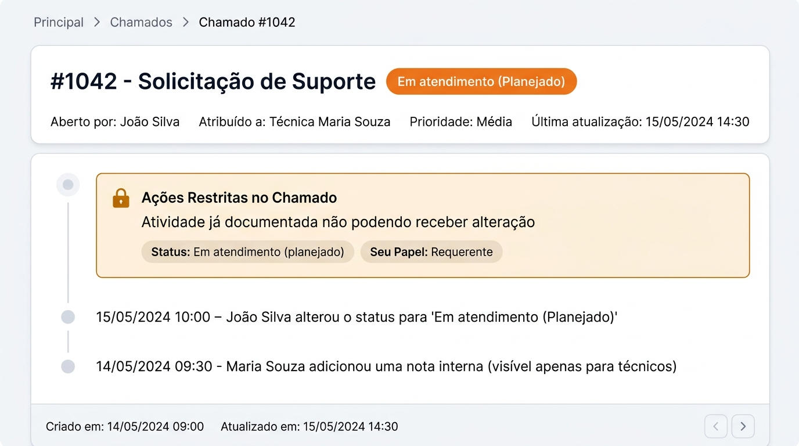

# 🔒 Plugin Restrict Status para GLPI 10 & 11

<p align="center">
  
  
  
  
</p>

O **Restrict Status** é um plugin de governança e controle de fluxo operacional para o **GLPI 10 e GLPI 11**. Ele permite restringir com precisão cirúrgica a adição de **Acompanhamentos (Followups)**, **Soluções (Solutions)**, **Documentos (Anexos)** e **Tarefas (Tasks)** em chamados de acordo com o **Status do Chamado** e o **Perfil de Acesso do Usuário**. Quando um perfil possui restrição ativa, o usuário fica **totalmente bloqueado**, independentemente de qual seja o seu papel no chamado (*Requerente*, *Observador* ou *Técnico Atribuído*).

<p align="center">
  
</p>
<p align="center"><em>Exemplo da Timeline no GLPI 11 com banner de aviso informativo e botões de ação restritos/ocultos conforme regras do perfil e status.</em></p>

---

## 📑 Sumário

- [Visão Geral e Benefícios](#-visão-geral-e-benefícios)
- [Funcionalidades Principais](#-funcionalidades-principais)
- [Arquitetura de Segurança em Dupla Camada](#-arquitetura-de-segurança-em-dupla-camada)
- [Requisitos de Ambiente](#-requisitos-de-ambiente)
- [Instalação e Ativação](#-instalação-e-ativação)
- [Orientações de Uso (Passo a Passo)](#-orientações-de-uso-passo-a-passo)
  - [1. Configuração Global](#1-configuração-global)
  - [2. Configuração por Perfil de Acesso](#2-configuração-por-perfil-de-acesso)
  - [3. Bloqueio Individual de Itens por Status](#3-bloqueio-individual-de-itens-por-status)
  - [4. Visualização na Tela do Chamado](#4-visualização-na-tela-do-chamado)
  - [5. Central de Auditoria](#5-central-de-auditoria)
- [Estrutura de Arquivos](#-estrutura-de-arquivos)
- [Práticas de Segurança Aplicadas](#-práticas-de-segurança-aplicadas)
- [Licença](#-licença)

---

## 🎯 Visão Geral e Benefícios

Em ambientes corporativos de Service Desk e ITSM, frequentemente é necessário congelar a interação em determinadas etapas do ciclo de vida de um chamado. Por exemplo:

- **Chamado com status "Novo"**: Evitar que usuários adicionem múltiplos acompanhamentos ou anexos repetitivos antes da triagem técnica.
- **Chamado em "Pendente" ou "Planejado"**: Impedir alterações ou solução indevida enquanto se aguarda terceiros ou aprovação externa.
- **Chamado "Solucionado" ou "Fechado"**: Bloquear totalmente a inclusão de novas soluções, acompanhamentos ou documentos sem a devida reabertura do ticket.
- **Evitar solução indevida**: Garantir que perfis restritos nunca consigam abrir ou submeter formulários de solução (`ITILSolution`).

O **Restrict Status** resolve essa demanda aplicando bloqueios dinâmicos baseados diretamente no **Perfil de Acesso do Usuário**, tanto no navegador quanto diretamente no núcleo do banco de dados do GLPI.

---

## ✨ Funcionalidades Principais

- 🛡️ **Bloqueio Granular de Itens**:
  - **Acompanhamentos (`ITILFollowup`)**: Impede novos comentários e respostas na timeline.
  - **Soluções (`ITILSolution`)**: Oculta e bloqueia botões, menus e formulários de solução, além de impedir transição forçada para status Solucionado.
  - **Documentos (`Document` / `Document_Item`)**: Bloqueia upload de novos anexos ao chamado restrito.
  - **Tarefas (`TicketTask`)**: Impede a criação de tarefas em status congelados.
- 👥 **Bloqueio Total Baseado no Perfil**:
  - Aplicação estrita baseada no Perfil de Acesso do usuário, bloqueando o usuário integralmente independentemente do seu papel no chamado.
  - Elimina a complexidade de definição de papéis (requerente, observador, técnico), garantindo consistência total.
- 🏢 **Regras Específicas por Perfil de Acesso**:
  - Aba nativa **Restringir Status** integrada em **Administração > Perfis**.
  - Permite definir matriz de bloqueio por status para cada perfil (ex.: *Self-Service*, *Técnico*, *Secretaria*, etc.).
  - Perfis administrativos (como *Super-Admin*) podem ser definidos como isentos para manutenção.
- 📊 **Módulo de Auditoria com Paginação a 30 por Página**:
  - Registra tentativas de violação bloqueadas (`FollowupBlocked`, `SolutionBlocked`, `DocumentBlocked`, `TaskBlocked`).
  - Histórico de alterações e auditoria com listagem otimizada.
- 🎨 **Compatibilidade Visual GLPI 10 e 11**:
  - Suporte completo ao tema claro (*Light*) e escuro (*Dark Mode* / Tabler UI).
  - Alerta informativo limpo e discreto indicando o status e o perfil do usuário.

---

## 🧱 Arquitetura de Segurança em Múltiplas Camadas

O plugin opera com um modelo avançado de **Defesa em Profundidade (Defense-in-Depth)**:

```
[ Requisição do Chamado no GLPI ]
         │
         ▼
[ 1. Camada de Renderização do Servidor (GLPI Core) ]
  ├─ Hook timeline_answer_actions (CommonITILObject)
  │    └─ Define 'hide_in_menu' => true nos botões restritos
  │    └─ O Twig (footer.html.twig) NEM RENDERIZA os botões no HTML
  ├─ Hook item_can (CommonDBTM::can)
  │    └─ Nega direitos CREATE e UPDATE no nível nativo de entidades
         │
         ▼
[ 2. Camada Visual / Frontend ]
  ├─ Regras CSS prioritárias (display: none !important nos botões e dropdowns)
  ├─ JavaScript com MutationObserver (monitora rodapé e timeline em AJAX)
  ├─ Interceptação de eventos Bootstrap (show.bs.collapse)
  └─ Interceptação de submissão de formulários (submit prevent)
         │
         ▼ (Caso tente burlar via DevTools, AJAX manual ou API)
[ 3. Camada de Persistência no Backend (Segurança Definitiva) ]
  ├─ Hook pre_item_add (ITILFollowup, ITILSolution, Document, TicketTask)
  │    └─ Invalida a inserção ($item->input = false)
  ├─ Hook pre_item_update (Ticket)
  │    └─ Impede mudança manual de status para Solucionado
  └─ Registro automático no log de Auditoria
```

---

## ⚡ Requisitos de Ambiente

| Requisito | Versão Homologada |
| :--- | :--- |
| **GLPI** | **10.0.0 até 11.x** (GLPI 10 e GLPI 11) |
| **PHP** | **8.3.x** ou superior (PHP 8.3 com Backed Enums e tipagem estrita) |
| **Banco de Dados** | MariaDB 10.4+ ou MySQL 5.7+ / 8.0+ |
| **Extensões PHP** | `mysqli`, `json`, `session`, `curl` |

---

## 🚀 Instalação e Ativação

### Opção A: Via Console CLI do GLPI (Recomendado)

1. Extraia ou clone o repositório na pasta de plugins do seu GLPI:
   ```bash
   cd /caminho/do/glpi/plugins
   git clone https://github.com/wilterporto/restrictstatus.git restrictstatus
   ```
2. Instale e ative o plugin via console:
   ```bash
   php bin/console plugin:install restrictstatus
   php bin/console plugin:activate restrictstatus
   ```

### Opção B: Via Interface Web do GLPI

1. Coloque a pasta do plugin como `plugins/restrictstatus`.
2. No GLPI, acesse **Configurar > Plugins**.
3. Localize o plugin **Restringir Acompanhamentos por Status**.
4. Clique em **Instalar** e, em seguida, em **Habilitar**.

---

## 📖 Orientações de Uso (Passo a Passo)

### 1. Configuração Global
Acesse o menu **Configurar > Restringir Status**:
- **Ativar Plugin**: Chave mestre para habilitar/desabilitar as restrições no sistema.
- **Aplicar ao Mailgate**: Intercepta e rejeita respostas recebidas via coletor de e-mail em chamados restritos.
- **Exibir Alerta na Timeline**: Habilita o banner informativo visual na timeline dos chamados.
- **Mensagem Padrão**: Texto informativo exibido quando o status não tiver mensagem personalizada.

### 2. Configuração por Perfil de Acesso
Acesse **Administração > Perfis** e selecione o perfil desejado (ex.: *Self-Service* ou *Helpdesk*):
1. Clique na aba lateral **Restringir Status**.
2. **Modo de Restrição**:
   - *Aplicar Regras de Bloqueio*: Usuários operando sob este perfil ficarão totalmente bloqueados nos status e itens configurados, independentemente de qualquer papel no chamado.
   - *Isento de Restrições*: Usuários com este perfil nunca são bloqueados (ideal para Super-Admin e gestores).
3. **Exibir Alerta na Timeline**: Marque se deseja que um banner informativo seja renderizado na timeline do chamado.
4. **Mensagem Informativa Personalizada**: Defina um aviso específico para este perfil (opcional).

### 3. Bloqueio Individual de Itens por Status
Na seção **"Regras de Status Ativas no Sistema"** da tela do perfil:
- Para cada status do GLPI (*Novo*, *Em atendimento (atribuído)*, *Em atendimento (planejado)*, *Pendente*, *Solucionado*, *Fechado*):
  - Ative ou desative a regra para o status selecionado.
  - Selecione exatamente quais itens devem ser bloqueados para aquele status:
    - `[x] Acompanhamentos`
    - `[x] Soluções`
    - `[x] Documentos`
    - `[x] Tarefas`
  - Se desejar, insira uma justificativa específica (ex.: *"Atividade já documentada não podendo receber alteração"*).
- Clique em **"Salvar Configurações do Perfil"**.

### 4. Visualização na Tela do Chamado
Ao abrir um chamado sujeito a regras de restrição ativas:
- **Ocultação Cirúrgica dos Botões de Ação**: Os botões de *"Responder"*, *"Adicionar uma solução"*, *"Adicionar documento"* e *"Adicionar uma tarefa"* têm a renderização suprimida no núcleo do GLPI e são completamente ocultados, impedindo tentativas inválidas de submissão.
- **Banner Informativo de Restrição**: Se a exibição de alerta estiver habilitada no perfil, um banner moderno e integrado ao tema do GLPI 10 e 11 é exibido na timeline destacando:
  - O status operacional do chamado (ex.: *Em atendimento (Planejado)*, *Pendente*, etc.).
  - O perfil do usuário no GLPI.
  - A justificativa ou mensagem de orientação configurada pelo administrador.
- **Ambiente Limpo e Seguro**: Evita ruídos de comunicação e retrabalho, garantindo que o usuário compreenda com clareza o motivo pelo qual o chamado se encontra bloqueado.

### 5. Central de Auditoria
Acesse **Configurar > Restringir Status > Auditoria** (acesso exclusivo a Superadmin):
- Consulte cada tentativa de adição bloqueada pelo sistema com data/hora, número do chamado, status, perfil do usuário e motivo do bloqueio.
- A listagem conta com paginação nativa configurada em **30 registros por página**.

---

## 📂 Estrutura de Arquivos

```text
plugins/restrictstatus/
├── .gitignore                   # Arquivos ignorados pelo Git
├── LICENSE                      # Licença pública GNU General Public License v3.0
├── README.md                    # Apresentação e documentação de uso do plugin
├── setup.php                    # Inicialização, requisitos e registro de hooks do GLPI
├── hook.php                     # Rotinas de instalação, desinstalação e listeners de hooks
├── docs/
│   └── images/
│       └── timeline_preview.jpg # Imagem demonstrativa da apresentação na timeline
├── ajax/
│   └── check_restriction.php   # Endpoint assíncrono para validação dinâmica na interface
├── css/
│   └── restrictstatus.css       # Estilos do banner e regras de isolamento visual CSS
├── front/
│   ├── config.php               # Painel de controle global e aba de auditoria
│   └── profile.form.php         # Roteamento seguro de formulários do perfil
├── inc/
│   ├── audit.class.php          # Módulo de auditoria e paginação a 30 por página
│   ├── config.class.php         # Modelo de persistência e configurações de status
│   ├── enums.class.php          # Enumeradores tipados em PHP 8.3 (Itens, Ações e Papéis)
│   ├── menu.class.php           # Integração com os menus administrativos do GLPI
│   ├── profile.class.php        # Gerenciador de regras e aba de Perfis de Acesso
│   └── restriction.class.php    # Motor de avaliação e validação das regras de negócio
└── js/
    └── restrictstatus.js        # Script cliente com MutationObserver e bloqueio de UI
```

---

## 🔒 Práticas de Segurança Aplicadas

1. **Proteção Contra SQL Injection**:
   - Uso obrigatório de Prepared Statements e da API nativa do GLPI (`$DB->request()`, `$DB->insert()`, `$DB->update()`). Nenhuma variável é concatenada em strings SQL.
2. **Proteção Anti-CSRF**:
   - Todos os formulários possuem tokens anti-CSRF validados via `Session::checkCSRF($_POST)` e `Html::closeForm()`.
3. **Proteção Contra XSS**:
   - Todas as saídas de dados no HTML e em atributos JavaScript passam por escape estrito via `htmlspecialchars` com `ENT_QUOTES, 'UTF-8'`.
4. **Isolamento de Sessão e Multitenancy**:
   - Validações de perfil ativo, herança de entidades (`entities_id`) e restrições conforme permissões do usuário em sessão.

---

## 👤 Autor

Desenvolvido por **Wilter Porto** ([@wilterporto](https://github.com/wilterporto)).

---

## 📄 Licença

Este plugin é software livre distribuído sob os termos da licença **GNU General Public License v3.0 (GPLv3+)**. Consulte o arquivo [LICENSE](file:///c:/wamp64/www/glpi11/plugins/restrictstatus/LICENSE) para mais informações.
